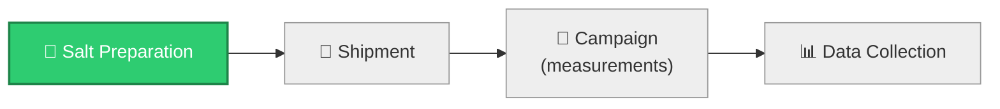

<div align="center">

# ⚗️ ENDURANCE Molten Salt Round Robin 2.0

**Work Package 2 — Chemistry of fuel salt and structural materials in reactor environment**


</div>

---

## 🚦 Where we are



The two demonstrator salts are being synthesized/purified now. Shipment, the
measurement campaign, and data collection follow — see
[`ENDURANCE-Main`](https://github.com/ENDURANCE-Round-Robin/ENDURANCE-Main)
for the up-to-date status and full detail.

---

## 🧭 About

This organization is the data-collection platform for the **Molten Salt Round
Robin 2.0**, an inter-laboratory benchmarking campaign run under the
**ENDURANCE Project**, Work Package 2. Participating laboratories independently
measure thermo-physical and thermochemical properties of two molten salt
systems, so results can be compared across labs to build a common, traceable
foundation for benchmark analysis.

## 🕶️ How anonymization works

Each participating laboratory is assigned a **private repository identified
only by a codename** (e.g. `RR2XXX`). No repository, filename, or document
reveals a lab's identity — participants enter their codename only, and every
lab can see **only their own repository**. Cross-lab comparison is performed
centrally by the organizers once the campaign concludes.

## 📁 Repository map

| Repository | Access | Purpose |
|---|---|---|
| **Participant repositories** (`RR2xxxx`) | Private — one per lab | Where each lab uploads its own experimental data and documentation. The only repos participants write to. |
| [`ENDURANCE-Main`](https://github.com/ENDURANCE-Round-Robin/ENDURANCE-Main) | Read-only for all participants | Instructions, reporting templates, naming/structure conventions, the **KMT machine-readable submission framework** (`kmt/`), and a fully worked example (`Example/`) showing the expected folder structure and file naming for every property and salt. |

## 🧬 Machine-readable submission (KMT)

Alongside the Word/Excel forms, labs can submit a short annotated `.yaml` +
`.csv` instead — checked automatically for completeness before submission.
The Word/Excel forms stay for now; machine-readable is the stressed,
preferred path going forward. See `ENDURANCE-Main/kmt/README.md`.

## 🧂 Salt systems under investigation

- NaCl–NdCl3 (64.5–35.5 mol%)
- NaF–KF–NdF3 (22.1–57.8–20.1 mol%)

## 📏 Properties covered

Density · Melting temperature · Transition temperature · Enthalpy of fusion ·
Heat capacity · Viscosity · Thermal conductivity · Vapour pressure · Thermal
diffusivity · Surface tension · Corrosion · Volatility · Oxygen analysis

## 📄 Submission structure at a glance

```text
Salt/
└── RR2-#-Property/
    └── Technique_Name/
        ├── Documentation/
        ├── Results/
        ├── Images/
        └── Supporting_Materials/
```

Every property folder always contains at least one technique-named
subfolder — see `ENDURANCE-Main/Example/` for the complete reference example
and full instructions.

## ✉️ Questions or access requests

Contact **Aya Zayat** — aya.zayat@polimi.it

